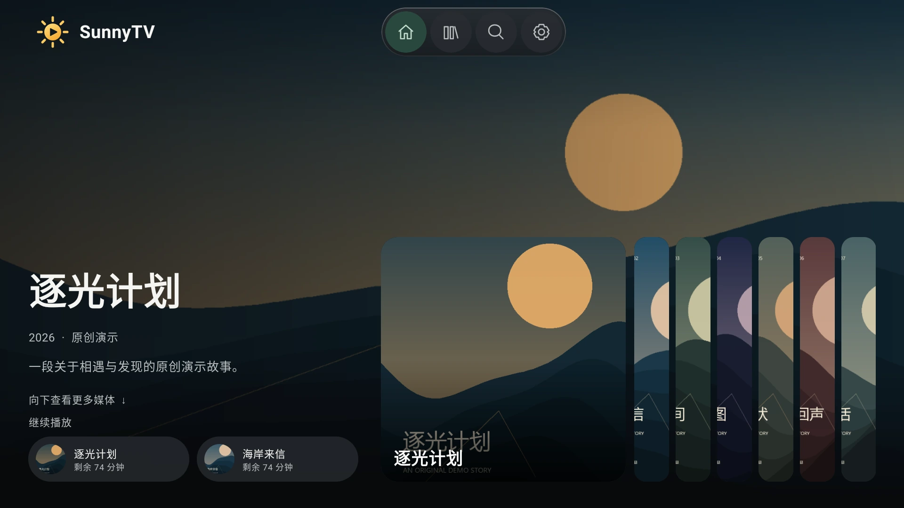
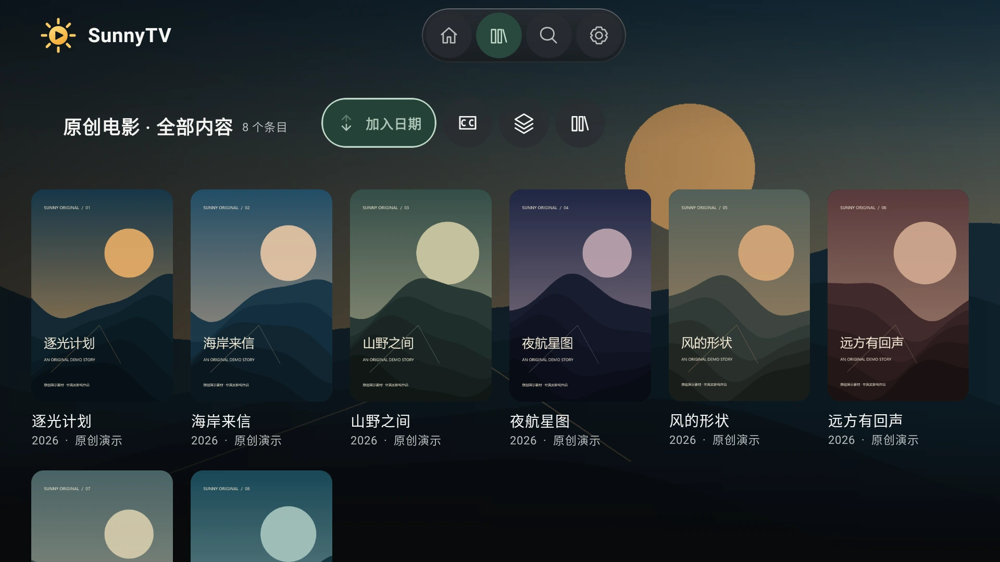
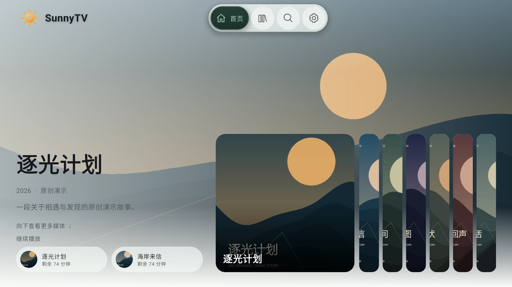
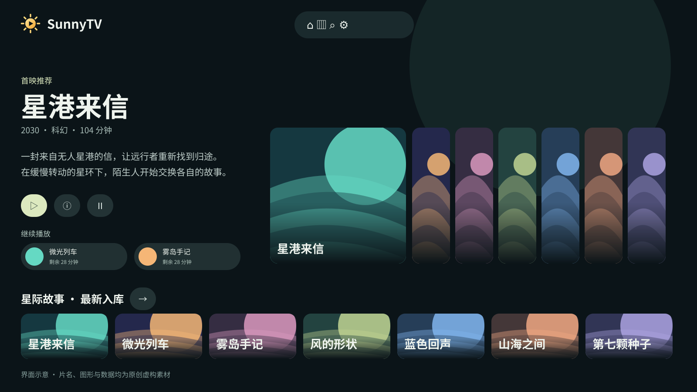
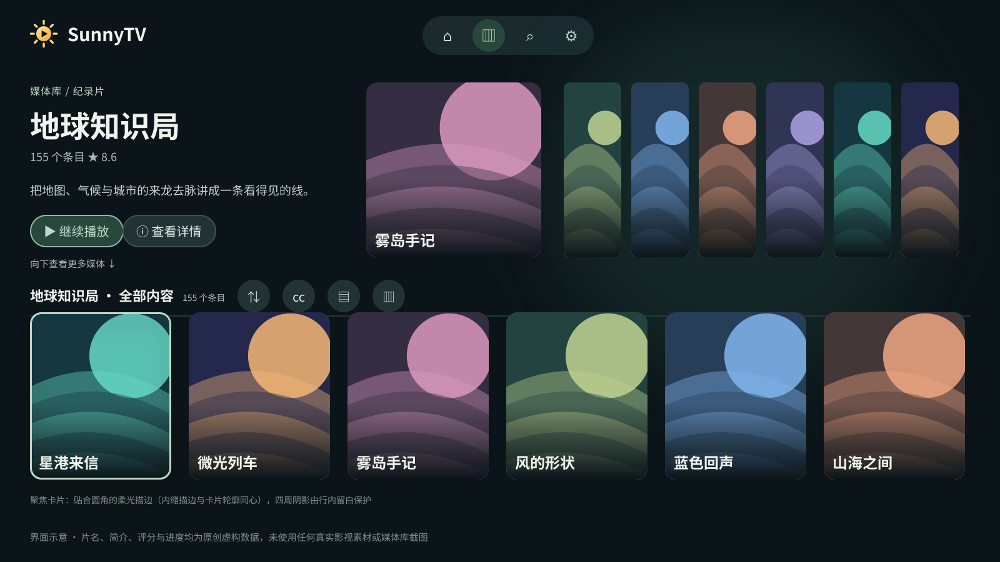
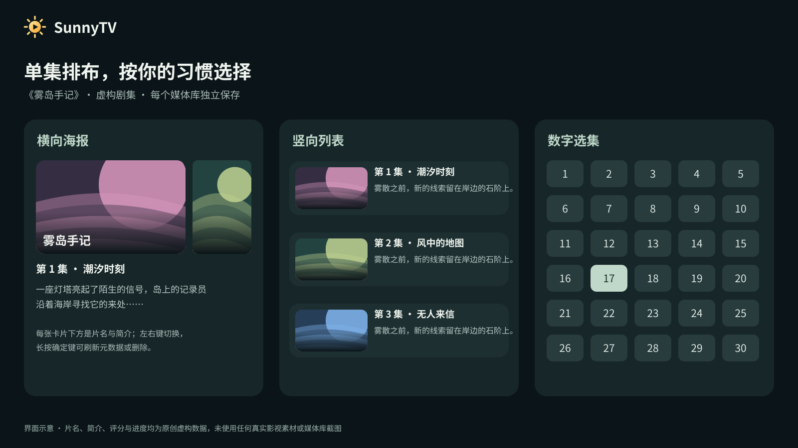
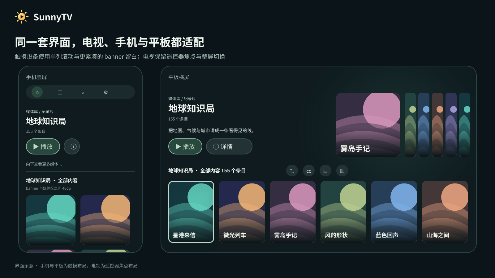

<p align="center"></p>
<h1 align="center">SunnyTV</h1>
<p align="center">让自己的媒体库，回到大屏。</p>

<p align="center">
  <a href="https://sunnytv.dunn.fun:666/">官方网站</a> ·
  <a href="https://github.com/xudong7587/SunnyTV/releases/latest">下载最新版</a> ·
  <a href="CHANGELOG.md">版本记录</a> ·
  <a href="docs/STATUS.md">开发状态</a> ·
  <a href="docs/KNOWN-ISSUES.md">已知问题</a> ·
  <a href="docs/BUILD.md">构建说明</a>
</p>

SunnyTV 是基于 Kotlin、Compose for TV 与 Media3 的原生 Android 客户端，支持 Emby 与绿联影视中心，
同时保留 MediaIndex STRM / 重定向播放与 CloudDrive2 WebDAV 兼容能力。应用不内置任何影视内容，
需要连接你自己的媒体服务；海报、背景、透明片名 Logo 与单集封面都直接复用 Emby 已有素材，不重新刮削。

**电视与手机/平板同一套界面**：电视保留遥控器焦点导航与「banner ↔ 媒体区」整屏切换；
手机与平板改为可触摸的单列滚动，并收紧了 banner 与媒体区之间的留白。

官网：**[sunnytv.dunn.fun:666](https://sunnytv.dunn.fun:666/)**。Android 安装包始终从 [GitHub 最新正式版](https://github.com/xudong7587/SunnyTV/releases/latest) 获取，后续版本采用纯数字编号。

## 亮点

- **流畅**：焦点与滚动按遥控器节奏设计——整屏切换只做 GPU 平移，网格跨行先交接焦点再滚动，
  详情页进入即停在「播放 / 继续播放」上、按上回顶部导航、再按下回到按钮，连续按键不丢焦点、不抖屏。
- **美观**：深浅主题、26 套配色与莫奈/自定义色，海报墙、banner、详情页与播放器共用同一套渐变、柔光与留白；
  焦点框与卡片圆角同心，行内预留阴影空间，聚焦不改变卡片几何。
- **STRM 支持好**：STRM 一律按「文件内唯一一条 HTTP(S) 地址」处理，支持 302/重定向、带签名的直链与
  Emby 服务端取流；电视直连失败时自动改用 Emby 服务端读一次，失败原因写到能看懂（主机 + 阶段）。
- **大视频与高码率体验**：播放传输单独放宽首次响应预算（连接 15 秒 / 读取 60 秒），缓冲按物理内存配置，
  首帧前的瞬时传输失败自动重试一次；原画直放优先，不申请转码。
- **字体与界面大小自定义**：可导入自己的 TTF / OTF / TTC 作为界面或字幕字体，
  界面缩放、字号、字幕外观（描边 / 位置 / 背景 / 大小）与动画速度都能单独调整。
- **多端自适应**：同一份界面适配电视（遥控器焦点导航）与手机 / 平板（单列触摸滚动），
  横竖屏、安全区与「按文件夹 / 按海报」浏览方式自动处理。
- **性能优化**：启动快照缓存、图片按「来源 + 条目 + 类型 + tag + 尺寸」缓存、低负载模式与界面分辨率偏好，
  低内存设备自动降低解码尺寸与阴影绘制。

## 主要功能

- **绿联影视中心**：独立连接入口与开通指引，通过 Emby 兼容接口浏览电影、剧集与合集，读取播放源和续播信息；支持有界读取完整当前目录后在 SunnyTV 内排序。部分服务端管理和字幕操作受接口能力限制。
- **首页**：一大一小两段式 banner 轮播（随机推荐 / 最新入库 / 继续观看），按「上」或下拉可换一批；
  下方是「我的媒体库」与每个媒体库的最新入库行。
- **媒体库**：banner 推荐 + 工具行 + 海报墙。每个媒体库独立保存展示方式（海报 / 背景 / 横幅）、
  排序（最新入库 / 最新上映 / 随机）、字幕优先级、单集排布与「按文件夹」浏览。
- **详情页**：简介、版本（多资源）、演职员表、相似推荐与全部剧集，可标记已看/收藏并写回 Emby。
- **播放器**：Media3 直连与 STRM/重定向播放、音轨与字幕轨道选择、章节、片头/片尾跳过提示、
  1x / 1.25x / 1.5x / 2x 倍速、字幕外观（字体、大小、描边、位置、背景，带实时预览）、
  电视遥控器长按左右连续快进快退、手机分区手势（亮度/音量/进度）与双击控制。
  手机和平板可在播放页锁定当前方向，躺卧观看时画面保持稳定；解锁后恢复自动旋转。
- **外观**：深浅主题、26 套配色、莫奈/自定义色、独立圆角及按设备能力回退的玻璃材质；五档界面大小与独立字号、五档动画速度与完全关闭。
- **字体**：系统默认字体，或自己导入 TTF / OTF / TTC（只保存在本机）。**仓库与安装包不含任何字体文件。**
- **搜索**：遥控器键盘 + 本地拼音首字母匹配（输入 `sdyq` 可命中「速度与激情」，无需联网、不内置词典）。
- **云盘**：CloudDrive2 WebDAV 只读浏览与播放，不提供删除、移动、重命名。
- **性能**：启动快照缓存、图片按「来源 + 条目 + 类型 + tag + 尺寸」缓存、低负载模式、界面分辨率偏好。
- **软件升级**：优先使用 GitHub 官方更新；可开启 WebDAV，从自己的目录下载与官方最新版同名、同签名的 APK。安装由 Android 系统确认。

## 液态玻璃源码

液态玻璃是 SunnyTV 的组成部分，随主项目继续开源，使用根目录 [GPL-3.0 许可证](LICENSE)。实现包含背景层采样、非色散折射、双峰高光与缓存模糊；Android 13 及以上使用 RuntimeShader，低版本按能力回退。

源码入口：[LiquidGlass.kt](app/src/main/java/io/github/xudong7587/sunnytv/feature/ui/LiquidGlass.kt)、[GlassShaders.kt](app/src/main/java/io/github/xudong7587/sunnytv/feature/ui/GlassShaders.kt) 和 [NativeAppearance.kt](app/src/main/java/io/github/xudong7587/sunnytv/feature/ui/NativeAppearance.kt)。接入方式、透明度参数、性能边界和上游声明见 [液态玻璃说明](docs/LIQUID-GLASS.md)。上游 shader 摘录的 Apache-2.0 许可和版权声明保留在 [third_party/miuix-glass](third_party/miuix-glass)。

## 原生界面截图







以上由 Android 模拟器中的真实 Compose 页面直接截图，片名、简介和海报均为原创演示内容；未使用用户媒体库或真实影视素材。[截图方法](website/README.md)。

<details><summary>早期界面结构示意</summary>

## 界面示意









以上均为界面示意图：片名、简介、年份、评分、进度与海报图形全部是原创虚构数据，未使用任何真实影视素材，
也不是用户媒体库截图；图形由 [本地脚本](scripts/generate-readme-art.py) 生成（纯手写 SVG，无外部图片、字体或网络请求）。

</details>

## 连接绿联影视中心

1. 在支持媒体服务器功能的影视中心版本中，打开「设置 → 服务管理 → 媒体服务器」。
2. 开启媒体服务器，创建独立的媒体库专用账号和密码。
3. SunnyTV「设置 → 媒体来源 → 添加绿联影视服务」填写实际 HTTPS 服务地址与专用账号。无需填写 NAS 管理员密码；地址可填根入口或 `/emby/`，客户端会规范化路径。
4. 外网使用已配置的可访问 HTTPS 域名与外部端口，证书需受设备信任。不要填写 UGOS 桌面登录页。

使用 Emby 兼容媒体服务器与申请 NAS UPK 安装测试的 `ugdev.sig` 设备签名是两条不同的流程。当前适配不代表已获得绿联专项 API 合作认证。

绿联本地排序只读当前目录，不修改 NAS。MediaIndex 115 云端清晰度需保留有效的原始 `/api/play/` 入口；仅有最终 CDN 直链时不能恢复其授权或云端档位。

## 快速开始

需要 JDK 17 或 21 与 Android SDK 35（`platforms;android-35`、`build-tools;35.0.0`）。

```bash
./gradlew assembleDebug testDebugUnitTest lintDebug
```

Windows 用 `gradlew.bat`。发布包在 [最新正式版](https://github.com/xudong7587/SunnyTV/releases/latest) 下载，
或安装刚构建出来的调试包：

```bash
adb install -r app/build/outputs/apk/debug/app-debug.apk
```

首次使用进入「设置 → 媒体来源」选择 Emby 或绿联影视服务并填写地址与专用账号；云盘填 CloudDrive2 的 **WebDAV** 地址
（不是管理后台地址）。凭据按来源保存，只在本机。

## 软件升级

「设置 → 软件升级」上方为 GitHub 官方更新，下方为默认关闭的 WebDAV 更新开关。
开启 WebDAV 后才显示目录 URL、用户名、密码、保存和自动更新选项；关闭会停止下载，保留本机加密保存的配置。
目录 URL 示例：`https://nas.example/dav/updates/`。带空格的路径使用 `%20`，Windows 盘符不能作为终端地址。

0.2.5 起先查询 GitHub latest，再下载 WebDAV 目录内与官方最新版同名的 `SunnyTV-v版本.apk`，
不需要 WebDAV JSON 清单。需要能连接 GitHub 查询最新版本；APK 下载走自己的 WebDAV。
下载后核对包名、数字版本、versionCode 与已安装应用的签名，拒绝降级和错误包，然后打开系统安装确认。
首次需要允许 SunnyTV 安装未知应用，授权后返回点「安装更新」。

WebDAV 开关和「自动更新」同时开启时，启动或回到前台会检查更新。发布工具仍保留旧版 JSON 入口供旧客户端升级；
详情见 [升级分发说明](docs/WEBDAV_UPDATES.md)。GitHub 官方渠道继续核对官方 SHA-256。

播放时点击右上角的实时信息按钮，可在左上角查看分辨率、帧率、音视频格式、码率、实际接收速度、缓冲和解码器。
使用界面字体，每秒刷新；开关状态会保留。下载速度为播放器收到的字节数，缓冲充足未下载时为 0，不能代表宽带测速结果。

## 验证与设备兼容

编译、单元测试、HTTP 回归与模拟器测试的执行结果见 [开发状态](docs/STATUS.md)，
遗留问题见 [已知问题](docs/KNOWN-ISSUES.md)。模拟器结果不能代替实体电视或手机验收；
高码率播放、HDR、杜比与不同厂商的安装权限仍需实机反馈。

## 实现取向

- 页面全部是原生 Compose / Media3，**不用 WebView 承载任何主页面**。
- 网络策略集中在 `core/network`（来源与路径作用域凭据、有界重定向、严格 TLS、统一播放 UA、可取消请求、不记录签名 URL）。
- API URL 只在 `source/` 适配器里拼装，UI 不直接构造接口地址，播放器不接触云盘 Cookie。
- 焦点效果不改变卡片几何；柔和阴影用缓存的轮廓描边带绘制，描边与卡片圆角同心，行内预留阴影留白。
- 多来源互不合并：同一时间只显示所选 Emby 来源，切换来源保留浏览配置，取消旧搜索并清理搜索结果。

主要目录：

```
app/src/main/java/io/github/xudong7587/sunnytv/
  core/model     展示逻辑、设置模型、策略（纯 Kotlin，可单测）
  core/network   HTTP 策略与安全传输
  core/storage   配置、字体、启动快照
  core/playback  播放会话、进度回报、启动计时
  feature/ui     首页、媒体库、详情、设置等界面
  feature/player 播放器与手势
  source/emby    Emby 适配器（含元数据与图片 URL）
  source/clouddrive, source/strm  WebDAV 与 STRM / 重定向
```

## 已知限制

- 模拟器验证不等于实体电视验收；真实设备上的遥控器手感、触摸手感与高码率播放仍需实机反馈。
- 8 项仪器化断言落后于已被验收的界面行为，未通过跳过测试的方式掩盖，逐条列在 [docs/KNOWN-ISSUES.md](docs/KNOWN-ISSUES.md)。
- 云端只读：不做删除、移动、重命名；应用内不提供文件管理。

## 开源许可

原创代码与原创示意图采用 [GPL-3.0-only](LICENSE)。分发修改后的版本须遵守 GPL 的源码提供、
许可证与署名保留要求；GPL 允许商业使用。第三方组件的许可证见 [第三方声明](THIRD_PARTY_NOTICES.md)。
